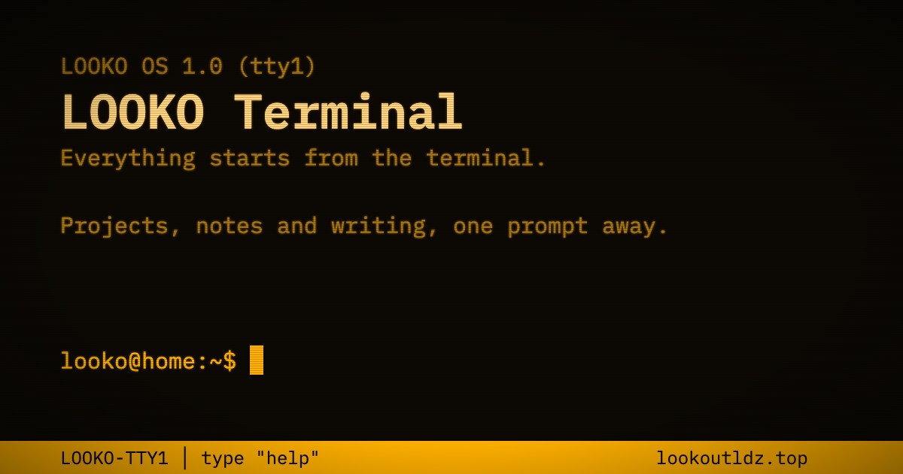

# LOOKO Terminal

> Everything starts from the terminal.

Looko 的个人导航主页：整个网站就是一块琥珀色的 CRT 终端屏幕，所有项目入口都以终端输出的形式出现，可以直接点击，也可以输入命令打开。

线上地址：<https://lookoutldz.top>



## 特点

- **纯静态，零依赖**：原生 HTML、CSS 和 ES Modules，不需要框架，也不需要构建步骤。
- **像真的终端**：块状光标、命令历史（↑↓）、Tab 补全、命令执行期间按的回车会排队、Ctrl+C / Ctrl+L / Ctrl+U。
- **单色磷光**：只用一种琥珀色，靠亮度和反色区分信息；`theme green` 可以切换成绿色磷光。
- **只改一个文件**：所有项目都定义在 [`js/projects.js`](js/projects.js) 中，启动画面、`ls`、`open`、补全和短链都读取它。
- **短链**：`lookoutldz.top/moss` 这样的地址由 Cloudflare Pages Function 直接 302 跳转到对应项目。
- **分享链接**：`lookoutldz.top/?cmd=fastfetch` 打开后会自动输入并执行这条命令。

## 命令

| 命令 | 说明 |
| --- | --- |
| `help` | 列出命令 |
| `ls [-lah]` | 列出项目，`-l` 显示简介 |
| `open <目标>` | 打开项目，目标可以是序号、名称或别名 |
| `info <目标>` | 查看项目详情 |
| `about` | 关于作者 |
| `history` | 历史命令 |
| `theme [amber\|green]` | 查看或切换配色 |
| `man <命令>` | 命令用法 |
| `clear` | 清屏 |

另外还藏了一些彩蛋命令，比如 `sl`、`vim`、`fastfetch`、`tree`、`sudo`。完整说明见 [`requirements.md`](requirements.md)。

## 本地运行

页面使用以根路径开头的资源地址（如 `/js/main.js`），需要在仓库根目录启动一个静态服务器，直接双击打开 `index.html` 不行：

```bash
python3 -m http.server 8787
```

然后访问 <http://localhost:8787>。

这种方式下短链（`/moss` 等）不可用，因为它依赖 Cloudflare Pages Function。需要的话可以用 Cloudflare 的 Wrangler 在本地模拟：`npx wrangler pages dev .`。

## 测试

测试使用 Node.js 内置的测试运行器，不需要安装依赖（CI 使用 Node.js 24）：

```bash
node --test
```

推送到 `main` 或提交 PR 时，GitHub Actions 会自动运行测试。

## 增删项目

只需要编辑 [`js/projects.js`](js/projects.js)：

```js
{
  index: 1,
  name: "the-moss",          // 终端中显示的名称，也是短链 /the-moss
  aliases: ["moss"],         // 别名，同样可用于 open 和短链
  summary: "a digital garden of notes and thoughts", // 不超过 40 个字符
  url: "https://moss.lookoutldz.top/",
},
```

启动画面、项目数量、补全和短链都会自动更新，不需要修改其他文件。

## 目录结构

```text
index.html          页面结构（不包含项目数据）
_headers            Cloudflare Pages 响应头：CSP 与缓存
functions/[name].js 短链：按 projects.js 302 跳转
css/style.css       样式
js/projects.js      项目数据
js/commands.js      命令注册表
js/shell.js         分词、解析、补全（纯函数）
js/terminal.js      输出渲染、输入层、光标
js/main.js          启动流程与事件
js/theme-init.js    首次绘制前应用已保存的配色
tests/              node --test 测试
```

## 部署

部署在 Cloudflare Pages：仓库根目录直接作为站点根目录，不需要构建命令，`functions/` 目录会被自动识别。

Cloudflare 域名设置需要注意：

- **Browser Cache TTL** 设为 “Respect Existing Headers”，否则浏览器可能把旧版 JS 缓存一天。
- **Rocket Loader** 建议关闭。页面中的脚本已带 `data-cfasync="false"` 作为兜底，避免被它改写后无法启动。
- **Web Analytics** 所需的两个域名已加入 `_headers` 中的 CSP 白名单。

## 许可证

源代码使用 [MIT License](LICENSE)。

站点中的个人内容不在授权范围内，包括 `js/projects.js` 中的项目列表与简介、`about` 和 `.plan` 的文字，以及 `assets/` 中的图片。如果你基于这个项目做自己的主页，请换成你自己的内容。

字体 IBM Plex Mono 使用 [SIL Open Font License 1.1](assets/fonts/OFL.txt)。
